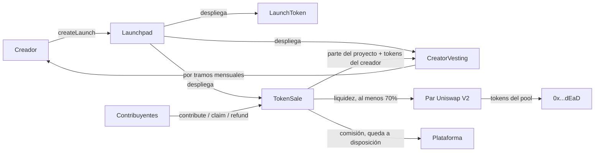
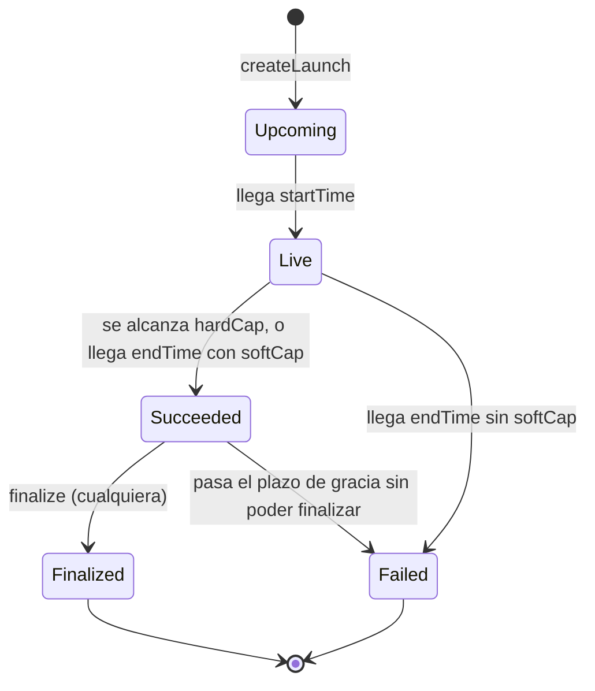

# Somewhere: lanzamiento de tokens fungibles — auditoría y propuesta de arquitectura

Fecha: 2026-10-11. Estado: **el Launchpad (secciones 3 a 7) está aprobado e implementado**; ver la sección 12. Parabolic y el Trust Graph (secciones 8 y 9) siguen siendo propuestas sin implementar.

La sección 1 describe el código tal como estaba antes de esta revisión y se conserva como registro de la auditoría.

Este documento cubre las fases 1 y 2 del encargo (`docs/prompt.txt` en la carpeta raíz del proyecto): qué hay hoy en el repositorio, qué falla, y cómo se propone construir lo que falta. Cada afirmación está marcada como **confirmada** (decidida por el responsable del producto), **propuesta** (recomendación sin aprobar) o **abierta** (falta decidir).

## 1. Fase 1: qué hay en el repositorio

### 1.1 Inventario

| Elemento | Estado |
|---|---|
| Stack | Solidity 0.8.28 (EVM cancun), Hardhat 3.19, OpenZeppelin 5.6, tests en TypeScript con viem |
| `Launchpad.sol` | Fábrica de lanzamientos a precio fijo. Implementada |
| `TokenSale.sol` | Venta de un token: contribuciones, listado, reembolsos. Implementada |
| `LaunchToken.sol` | ERC-20 de supply fijo, sin dueño. Implementado |
| `contracts/test/MockDex.sol` | Dobles de Uniswap V2 para los tests |
| Tests | 30 tests unitarios, todos pasan (`npm test`) |
| Despliegue | Módulo de Hardhat Ignition parametrizado; nunca ejecutado en una red real |
| Somewhere Parabolic (curva) | No existe |
| Vesting del creador | No existe |
| Trust Graph | No existe; pertenece sobre todo al backend |
| Solana | No existe; será un proyecto aparte |
| Tests de fuzzing e invariantes | No existen |
| Análisis estático | No se ha ejecutado ninguno |
| Auditoría externa | No se ha hecho |

El árbol de git estaba limpio y sincronizado con `origin/main` al empezar.

### 1.2 Privilegios que existen hoy

| Quién | Qué puede hacer | Límite |
|---|---|---|
| Dueña del `Launchpad` (la plataforma) | Cambiar la comisión de los lanzamientos futuros | Tope en el contrato (hoy 5%) |
| Dueña del `Launchpad` | Cambiar quién cobra la comisión de los lanzamientos futuros | No puede ser la dirección cero |
| Dueña del `Launchpad` | Ceder o renunciar a la propiedad | Cesión en dos pasos |
| Creador de un lanzamiento | Nada tras crearlo | — |
| Cualquiera | Crear lanzamientos, contribuir, finalizar una venta exitosa | Reglas del contrato |

No hay proxies ni mecanismo de actualización, ni funciones para acuñar, pausar, confiscar, poner en lista negra o cambiar un lanzamiento ya creado.

### 1.3 Hallazgos

Los dos primeros se comprobaron con tests temporales que reproducen el fallo; los tests se retiraron después.

| # | Gravedad | Hallazgo |
|---|---|---|
| H1 | **Alta** | **Fondos atrapados si el cobro de la comisión falla.** `finalize` envía la comisión a la dirección de cobro. Si esa dirección es un contrato que no acepta moneda nativa, `finalize` revierte siempre. La venta queda en "exitosa" para siempre: no se puede listar ni reembolsar. Comprobado: un año después los contribuyentes seguían sin poder recuperar nada. |
| H2 | Media | **Fondos atrapados si el exchange rechaza la liquidez.** No hay salida si la creación del par o `mint` revierten. Comprobado con un lanzamiento de tamaño ínfimo (supply de 2.000 unidades, máximo de 900 wei): el par exige una liquidez mínima que no se alcanza. Con parámetros normales no ocurre, pero cualquier fallo del exchange tendría el mismo efecto. |
| H3 | Media | **El creador recibe sus tokens de golpe** al listar y puede venderlos en el mismo bloque. El encargo exige vesting. |
| H4 | Media | **La comisión puede llegar al 5%.** El encargo fija un tope absoluto del 1%. |
| H5 | Baja | **Sin límites por wallet.** Una sola dirección puede comprar toda la venta. |
| H6 | Baja | **Sin cotas mínimas** para supply y recaudación, lo que permite lanzamientos degenerados como el de H2. |
| H7 | Info | Los tests del listado usan un doble del exchange. El comportamiento contra un Uniswap V2 real no está verificado. |
| H8 | Info | No está confirmado qué exchange compatible con Uniswap V2 existe en Robinhood Chain, ni las direcciones oficiales en cada red. |
| H9 | Info | Tras retirar todos los tokens pueden quedar unas pocas unidades mínimas en la venta por redondeo. No son reclamables por nadie. |

Revisados sin encontrar problema: reentrada (todas las funciones que mueven fondos están protegidas y siguen el orden comprobar, anotar, transferir), doble retiro y doble reembolso, desbordamientos (supply acotado a 10^33), y el bloqueo del listado creando el par por adelantado (hay un test que reproduce el ataque).

### 1.4 Diferencias entre lo construido y lo decidido

| Tema | Hoy | Decidido |
|---|---|---|
| Destino de lo recaudado | Todo a liquidez | Al menos 70% a liquidez; el resto al proyecto |
| Parte del proyecto | No existe | Se entrega con vesting, mínimo 3 partes mensuales |
| Bloqueo de la liquidez | Permanente | Permanente (sin cambios) |
| Comisión | 2% en los tests, tope 5% | 0,5% inicial, tope 1% |
| Vesting del creador | No hay | Obligatorio |
| Segundo producto (curva) | No hay | "Somewhere Parabolic", arquitectura aparte |

## 2. Requisitos confirmados

1. Dos productos con contratos separados: **Launchpad** (precio fijo) y **Parabolic** (curva de precio).
2. Solo tokens fungibles en este tramo. Lo de NFT queda pendiente, no descartado.
3. El creador recibe como máximo el **1% del supply**, con vesting.
4. En Launchpad, **al menos el 70% de lo recaudado va a liquidez**, y esa liquidez queda **bloqueada para siempre**.
5. El resto de lo recaudado se entrega al proyecto **con vesting, en un mínimo de 3 partes mensuales**.
6. Cuanto **más largo el vesting, mejor puntuación** del token en el Token Security Score.
7. Comisión de plataforma: **0,5% inicial, tope absoluto del 1%**. Un lanzamiento fallido no paga comisión.
8. Venta fallida: reembolso íntegro de cada contribución.
9. Sin acuñación posterior, sin listas negras, sin impuestos en el token, sin cambios de parámetros una vez creado el lanzamiento.
10. EVM primero, en testnet. Solana será una implementación aparte.
11. Nada se despliega en mainnet sin aprobación explícita y auditoría independiente.

## 3. Arquitectura propuesta: Somewhere Launchpad

### 3.1 Contratos

| Contrato | Responsabilidad | Estado |
|---|---|---|
| `LaunchToken` | ERC-20 de supply fijo, sin dueño | Existe, sin cambios |
| `Launchpad` | Valida los parámetros, despliega los tres contratos de cada lanzamiento, guarda la comisión vigente | Existe, se modifica |
| `TokenSale` | Contribuciones, límites por wallet, listado, reembolsos, retirada de tokens | Existe, se modifica |
| `CreatorVesting` | Custodia la parte del proyecto (moneda nativa) y los tokens del creador, y los libera por tramos | **Nuevo** |

Un contrato de vesting por lanzamiento, igual que la venta: los fondos de un lanzamiento nunca comparten contrato con los de otro.

### 3.2 Reparto de lo recaudado

Al finalizar una venta exitosa, con `R` = total recaudado:

| Destino | Cuánto | Cómo |
|---|---|---|
| Comisión | `R × feeBps` (0,5%) | Queda anotada en la venta; la plataforma la retira cuando quiera |
| Liquidez | `R × liquidityBps`, con `liquidityBps` de al menos 70% | Al par del exchange; los tokens del pool van a `0x…dEaD` |
| Proyecto | El resto | Al contrato de vesting |

- El creador elige `liquidityBps` al crear el lanzamiento, entre el 70% y el `100% − comisión`.
- La comisión se calcula sobre el total recaudado y sale de la parte que no es liquidez, de modo que el 70% mínimo es siempre el 70% de lo recaudado. **Propuesta.**
- Que la comisión quede a disposición en lugar de enviarse resuelve H1: un fallo al cobrarla ya no puede bloquear el listado.

### 3.3 Reparto del supply

El token sale a negociarse al mismo precio de la venta. Para eso, los tokens que acompañan a la liquidez guardan la misma proporción que la moneda nativa:

- Creador: lo que elija, hasta el 1%.
- Venta: `(supply − creador) / (1 + liquidityBps)`.
- Reserva de liquidez: `venta × liquidityBps`.

Con el 70% a liquidez y el 1% al creador: 58,2% a la venta y 40,8% a la reserva de liquidez. Lo no vendido se quema con su parte de la reserva. **Propuesta**: mantiene la regla actual de "se lista al precio pagado".

### 3.4 Vesting

- El creador elige el número de tramos mensuales al crear el lanzamiento, con un **mínimo de 3**. Tope propuesto: 48.
- Un tramo son 30 días. Todos los tramos son iguales.
- La parte del proyecto y los tokens del creador siguen **el mismo calendario**. **Propuesta.**
- Nadie puede adelantar, pausar ni redirigir el vesting: el contrato no tiene dueño. El beneficiario es el creador y no se puede cambiar. **Propuesta.**
- El calendario queda en un evento y en variables públicas, para que el Trust Graph lo lea.

### 3.5 Máquina de estados

La transición nueva es de `Succeeded` a `Failed`: si una venta exitosa no se consigue finalizar en un plazo de gracia tras su fin (**propuesta**: 7 días), pasa a fallida y todos pueden pedir el reembolso. Resuelve H2 sin dar a nadie un poder discrecional: `finalize` sigue siendo de libre llamada, así que el plazo solo vence si el exchange lo impide.

### 3.6 Sobredemanda

| Opción | Cómo funciona | A favor | En contra |
|---|---|---|---|
| A. Rechazar | La contribución que no cabe entera revierte | La más simple | El último tiene que adivinar cuánto queda |
| **B. Aceptar hasta llenar** (actual) | Se acepta lo que cabe y el resto se devuelve en la misma transacción | Simple, sin reembolsos posteriores, nadie queda con dinero retenido | Gana quien llega primero |
| C. Prorrateo | Se acepta todo y al final se reparte en proporción | Reparto parejo | Retiene dinero de todos, invita a inflar contribuciones, mucho más código |

**Propuesta: B**, junto con el límite máximo por wallet para repartir mejor. Ningún modelo impide que una persona use varias wallets.

### 3.7 Parámetros de un lanzamiento

Los fija el creador al crear el lanzamiento y no se pueden cambiar después.

| Parámetro | Regla |
|---|---|
| Nombre, símbolo, supply | Supply hasta 10^15 tokens; mínimo propuesto: 1.000 tokens |
| Parte del creador | Hasta el 1% |
| `softCap`, `hardCap` | `softCap` no mayor que `hardCap`; mínimo propuesto para `softCap`: 0,01 de moneda nativa |
| Inicio y fin | Inicio hasta 90 días vista; duración hasta 30 días |
| `liquidityBps` | Del 70% al `100% − comisión` |
| Tramos de vesting | De 3 a 48 |
| Contribución mínima y máxima por wallet | Opcionales |

### 3.8 Privilegios

Sin cambios respecto a hoy, salvo el tope: la plataforma solo fija la comisión de los lanzamientos futuros (nunca por encima del 1%) y la dirección que la retira. Sin proxies ni actualizaciones: una versión nueva del protocolo es un despliegue nuevo, y los lanzamientos anteriores siguen con sus reglas. **Propuesta.**

## 4. Invariantes del Launchpad

Se escribirán como tests de invariantes antes de dar por buena la implementación.

1. El supply de un token nunca cambia tras su creación.
2. La parte del creador nunca supera el 1% del supply.
3. La comisión nunca supera el 1% de lo recaudado, y es cero en una venta fallida.
4. La liquidez recibe al menos el 70% de lo recaudado en toda venta finalizada.
5. Los tokens del pool de una venta finalizada pertenecen a `0x…dEaD` y a nadie más.
6. Mientras una venta no está finalizada ni fallida, su saldo de moneda nativa es igual a la suma de las contribuciones.
7. En una venta fallida, la suma de reembolsos posibles es igual al saldo del contrato.
8. La suma de tokens reclamables nunca supera los tokens que la venta conserva.
9. Nadie retira tokens ni reembolso dos veces.
10. Una venta finalizada o fallida no vuelve a ningún otro estado.
11. El vesting nunca libera más de lo que corresponde a los tramos vencidos, ni a otro beneficiario.
12. Ningún parámetro de un lanzamiento cambia tras crearlo.

## 5. Modelo de amenazas

| Amenaza | Defensa | Riesgo que queda |
|---|---|---|
| Creador que vacía la liquidez | Liquidez quemada; el creador nunca la toca | Ninguno por esta vía |
| Creador que abandona tras cobrar | Parte del proyecto y tokens con vesting mensual | Cobra los tramos ya vencidos |
| Creador que vende su parte al listar | Tokens del creador con vesting | Puede comprar en su propia venta con otras wallets |
| Plataforma abusiva o clave comprometida | Solo controla comisión futura (tope 1%) y su cobro | Puede subir la comisión futura hasta el 1% |
| Bloqueo del listado creando el par antes | El par se fondea directamente, sin el router | El atacante solo regala su dinero al pool |
| Exchange que falla o revierte | Plazo de gracia y reembolso | Los contribuyentes esperan el plazo |
| Reentrada | Guardas y orden comprobar, anotar, transferir | — |
| Errores de redondeo | Siempre a favor del contrato; tests de límites y fuzzing | Restos mínimos sin reclamar |
| Bots y adelantamiento de transacciones | Precio fijo; límite por wallet | Varias wallets por persona; no se puede impedir en cadena |
| Tokens maliciosos | El único token que maneja la venta es el `LaunchToken` que la propia fábrica despliega | — |
| Parámetros degenerados | Cotas mínimas y máximas | — |
| Error en el propio contrato | Tests, fuzzing, invariantes, auditoría externa | No se elimina; por eso no hay mainnet sin auditoría |

## 6. Estrategia de pruebas

| Tipo | Herramienta | Estado |
|---|---|---|
| Unitarias y de integración | Hardhat con `node:test` y viem | Existen 30; se amplían |
| Fuzzing e invariantes | Tests en Solidity de Hardhat 3 | Por hacer |
| Contra un Uniswap V2 real | Fork de Sepolia o mainnet | Por hacer; necesita una URL de nodo |
| Análisis estático | Slither | Por hacer; requiere instalar Python y Slither en la máquina |
| Verificación formal | — | No prevista en esta etapa |
| Auditoría independiente | Externa | Obligatoria antes de mainnet |

## 7. Dependencias externas

| Dependencia | Qué se asume | Qué pasa si falla |
|---|---|---|
| OpenZeppelin 5.6 | ERC-20, propiedad en dos pasos, guarda de reentrada, transferencias seguras | — |
| Fábrica y par de Uniswap V2 (o PancakeSwap V2) | `createPair`, `getPair` y `mint` se comportan como el original | El listado revierte; plazo de gracia y reembolso |
| Moneda nativa envuelta (WETH, WBNB) | `deposit` y `transfer` estándar | Igual que arriba |

El bloqueo de liquidez depende de que los tokens del pool sean fungibles y transferibles, como en Uniswap V2. Un exchange de liquidez concentrada (Uniswap V3) representa las posiciones como NFT y necesitaría otro mecanismo; no está en esta propuesta.

## 8. Somewhere Parabolic (curva de precio)

Arquitectura aparte, sin código compartido con el Launchpad salvo `LaunchToken`. Se diseña en detalle cuando el Launchpad esté cerrado. Lo que se puede adelantar:

- **Contratos previstos:** una fábrica y un contrato de curva por token, que custodia el inventario y la reserva y ejecuta compras, ventas y la graduación.
- **Reglas confirmadas que hereda:** supply fijo, creador hasta el 1% con vesting, liquidez bloqueada al graduarse, comisión de plataforma con tope del 1%, sin comisión de trading salvo aprobación expresa.
- **Graduación:** al alcanzarse el umbral se detienen las operaciones, se migra la reserva y el inventario restante al exchange en una sola transacción, se queman los tokens del pool y la curva queda cerrada para siempre. Si la migración revierte, la curva sigue operativa y se puede reintentar; no hay estado intermedio.

Todo lo económico está **abierto**: fórmula, precio inicial, inventario, umbral de graduación y si hay comisión por operación. Propuesta de partida para discutir: curva de producto constante con reservas virtuales, que es el modelo más extendido y el mejor estudiado.

## 9. Somewhere Trust Graph

Es sobre todo trabajo del backend (`somewhere.finance-back`), no de este repositorio. Los contratos solo aportan hechos verificables a través de sus eventos.

- **Lo que ya existe en el backend:** cuentas vinculadas a wallets por firma, con reto de un solo uso y caducidad.
- **Indexador:** lee los eventos de los contratos, los guarda de forma idempotente con cadena, bloque y transacción, y espera confirmaciones antes de darlos por firmes.
- **Token Security Score:** se calcula a partir de datos de cadena. Factores ya confirmados: porcentaje a liquidez, bloqueo permanente, parte del creador y **duración del vesting (más largo, mejor)**.
- **Creator Trust Score:** historial del creador dentro de Somewhere. No penaliza una venta fallida ni una caída de precio.
- Las puntuaciones son informativas: nunca modifican contratos, saldos ni permisos.

Fórmulas, pesos y el proceso de apelación están **abiertos** y se propondrán cuando llegue ese tramo.

## 10. Decisiones que necesitan aprobación

Aprobadas el 2026-10-11 por el responsable del producto, todas según la propuesta:

| # | Decisión | Propuesta |
|---|---|---|
| D1 | ¿Cuándo vence el primer tramo del vesting? | A los 30 días del listado, no el mismo día |
| D2 | ¿Los tokens del creador siguen el mismo calendario que su parte de lo recaudado? | Sí |
| D3 | Tope de tramos de vesting | 48 meses |
| D4 | Sobredemanda | Opción B: aceptar hasta llenar y devolver el resto |
| D5 | Base de la comisión | 0,5% del total recaudado, descontado de la parte que no es liquidez |
| D6 | Plazo de gracia para finalizar antes de permitir reembolsos | 7 días |
| D7 | Cotas mínimas | Supply de 1.000 tokens; `softCap` de 0,01 de moneda nativa |
| D8 | ¿Se lista al precio de la venta? | Sí, como ahora |
| D9 | Actualizaciones | Sin proxies; versión nueva, despliegue nuevo |

No bloquean todavía:

| # | Decisión |
|---|---|
| D10 | Fórmula y parámetros de la curva de Parabolic |
| D11 | Umbral de graduación de Parabolic |
| D12 | Exchange de destino en cada cadena, sobre todo en Robinhood Chain |
| D13 | Fórmulas y pesos de las dos puntuaciones |
| D14 | Proceso de apelación y confirmación de incidencias |
| D15 | Vinculación de varias wallets y recuperación de cuentas |
| D16 | Instalar Slither para el análisis estático |

## 11. Orden de implementación recomendado

1. Launchpad: comisión con tope del 1% y cobro a disposición (H1, H4), cotas mínimas (H6).
2. Launchpad: plazo de gracia y reembolso (H2).
3. Launchpad: reparto de lo recaudado con mínimo del 70% a liquidez.
4. Launchpad: `CreatorVesting` (H3).
5. Launchpad: límites por wallet (H5).
6. Launchpad: tests de fuzzing e invariantes de la sección 4.
7. Launchpad: prueba contra un Uniswap V2 real y despliegue en Sepolia.
8. Backend: indexador de eventos del Launchpad. Front: página Launchpad con datos reales.
9. Parabolic: diseño detallado, aprobación de parámetros, implementación.
10. Trust Graph en el backend.

Cada paso termina con sus tests ejecutados y un informe de lo hecho.

## 12. Estado de la implementación del Launchpad

Implementados los pasos 1 a 6 de la sección 11, el 2026-10-11.

| Hallazgo | Resolución |
|---|---|
| H1, fondos atrapados si falla el cobro de la comisión | La comisión queda apartada y se retira con `collectFee`; un fallo ahí no afecta a nada más. Test: "never blocks a launch when its recipient cannot be paid" |
| H2, fondos atrapados si el exchange rechaza la liquidez | Plazo de gracia de 7 días y reembolso. Test: "turns into a failed sale after the grace period, with full refunds" |
| H3, tokens del creador de golpe | `CreatorVesting` |
| H4, comisión hasta el 5% | Tope del 1% en el contrato |
| H5, sin límites por wallet | Mínimo y máximo opcionales |
| H6, sin cotas mínimas | Supply mínimo de 1.000 tokens; `softCap` mínimo de 0,01 |

Diferencias con la propuesta:

- **Quién cobra la comisión.** La venta no guarda una dirección de cobro propia: al retirar la comisión pregunta al `Launchpad` quién la cobra en ese momento. Así una dirección de cobro errónea se puede corregir. A cambio, la plataforma puede cambiar el destino de las comisiones ya devengadas, que son suyas.
- **El mínimo por wallet** se mide sobre el total aportado por la wallet, no sobre cada envío, y no se aplica a la aportación que completa la venta.
- **El plazo de gracia** cuenta desde que se alcanza el `hardCap` si la venta se llena antes de su fin. Una venta que se llena el primer día tiene 7 días desde ese momento, no desde `endTime`.

Pruebas ejecutadas con `npm test`: 67 pasan (51 unitarias en TypeScript, 7 de fuzzing y 9 invariantes en Solidity, con 256 ejecuciones cada una).

Las invariantes 1 a 11 de la sección 4 tienen test. La 12 (ningún parámetro cambia tras crear el lanzamiento) se cumple por construcción: todos los parámetros son `immutable` y no existe ninguna función que los modifique.

Comprobación de que los tests detectan errores: se introdujeron seis fallos deliberados, uno cada vez (doble reembolso, mínimo de liquidez al 60%, vesting un tramo adelantado, tokens del pool al creador, comisión descontada de la liquidez y plazo de gracia desactivado). Los seis hicieron fallar tests. Los contratos se restauraron después.

Prueba contra un Uniswap V2 real (2026-10-12): `test/LaunchpadFork.t.sol` ejecuta un lanzamiento completo sobre una copia local de Sepolia, con la fábrica y el router oficiales. Los 3 tests pasan: el token se lista en el par que la fábrica reconoce, con el 70% de lo recaudado como reserva; toda la liquidez queda en `0x…dEaD` salvo las 1.000 unidades que el propio Uniswap quema; el token se puede comprar y vender por el router a un precio a menos del 1% del de la venta; y el listado funciona aunque alguien cree y desequilibre el par antes. Esto cierra el hallazgo H7 para Sepolia.

Sobre el hallazgo H8: la página oficial de Uniswap lista una fábrica V2 en Robinhood Chain y otra en BNB Chain (ver el README). Falta probarlas.

No se ha hecho: análisis estático, despliegue en testnet ni auditoría externa.

Margen de tamaño: `Launchpad` ocupa 18.283 de los 24.576 bytes que admite la red. Si crece mucho más habrá que separar la creación de contratos.
